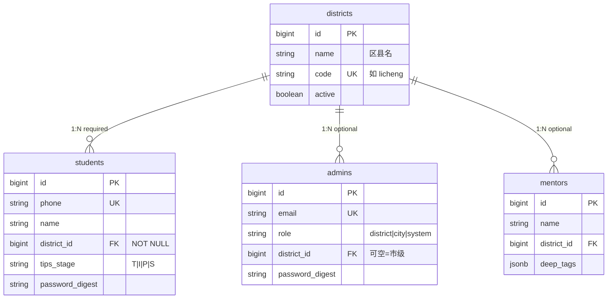
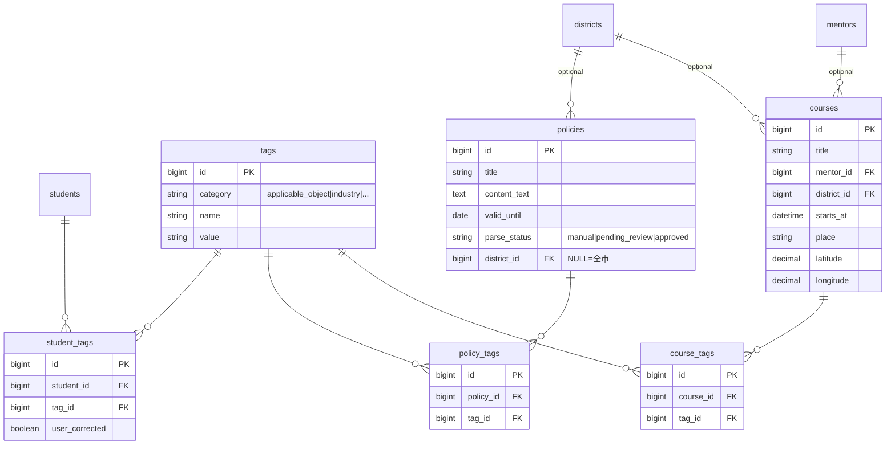
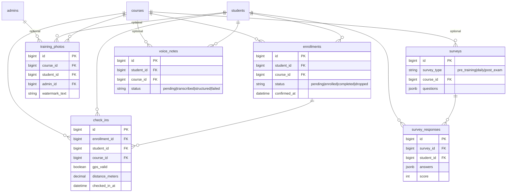
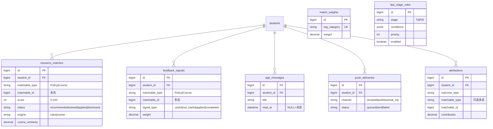
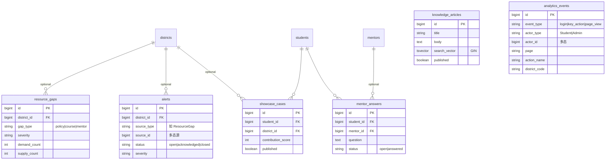

# 齐鲁农创客系统 · 实体关系图（ER）

依据 `react_demo_2` 时期 `db/schema.rb`（version `2026_07_14_000001`）与 `app/models/*` 关联绘制业务 ER。  
移植到 **agri3 / Litedb** 后：业务表结构语义保持一致；`jsonb` → `json`；**无** Postgres 扩展表；基础设施由 Litestack 文件承担（不进业务 ER）。  
**不移植** 遗留 `chat_messages`（pgbus 演示聊天）。

**图例**

| 符号 | 含义 |
|------|------|
| `PK` | 主键 |
| `FK` | 外键 |
| `UK` | 唯一约束（含联合唯一） |
| `◆` 实线 | 必选关联（`null: false`） |
| `◇` 虚线 | 可选关联（`optional` / 可空 FK） |
| `〔多态〕` | `type` + `id` 多态关联 |

---

## 1. 总览 ER（业务域）

```mermaid
erDiagram
  districts ||--o{ students : "has many"
  districts ||--o{ admins : "optional"
  districts ||--o{ policies : "optional citywide"
  districts ||--o{ courses : "optional"
  districts ||--o{ mentors : "optional"
  districts ||--o{ resource_gaps : "optional"
  districts ||--o{ alerts : "optional"
  districts ||--o{ showcase_cases : "optional"

  students ||--o{ student_tags : ""
  tags ||--o{ student_tags : ""
  students ||--o{ enrollments : ""
  courses ||--o{ enrollments : ""
  students ||--o{ resource_matches : ""
  students ||--o{ app_messages : ""
  students ||--o{ check_ins : ""
  students ||--o{ voice_notes : ""
  students ||--o{ push_deliveries : ""
  students ||--o{ survey_responses : ""
  students ||--o{ feedback_signals : ""
  students ||--o{ attributions : ""
  students ||--o{ showcase_cases : ""
  students ||--o{ mentor_answers : ""
  students ||--o{ training_photos : "optional"

  policies ||--o{ policy_tags : ""
  tags ||--o{ policy_tags : ""
  courses ||--o{ course_tags : ""
  tags ||--o{ course_tags : ""

  mentors ||--o{ courses : "optional"
  mentors ||--o{ mentor_answers : "optional"

  courses ||--o{ check_ins : ""
  courses ||--o{ training_photos : ""
  courses ||--o{ surveys : "optional"
  courses ||--o{ voice_notes : "optional"
  enrollments ||--o{ check_ins : ""

  surveys ||--o{ survey_responses : ""
  admins ||--o{ training_photos : "optional"

  districts {
    bigint id PK
    string name
    string code UK
    boolean active
  }

  students {
    bigint id PK
    string phone UK
    string name
    bigint district_id FK
    string primary_industry
    decimal scale
    decimal annual_income
    text honors
    string tips_stage
    jsonb profile
    string password_digest
  }

  admins {
    bigint id PK
    string email UK
    string name
    string password_digest
    string role
    bigint district_id FK
  }

  tags {
    bigint id PK
    string name
    string category
    string value
  }

  student_tags {
    bigint id PK
    bigint student_id FK
    bigint tag_id FK
    boolean user_corrected
  }

  policies {
    bigint id PK
    string title
    text content_text
    date valid_until
    string pdf_text
    string parse_status
    jsonb parsed_fields
    bigint district_id FK
    boolean published
  }

  policy_tags {
    bigint id PK
    bigint policy_id FK
    bigint tag_id FK
  }

  mentors {
    bigint id PK
    string name
    string phone
    string specialty
    text bio
    jsonb deep_tags
    bigint district_id FK
  }

  courses {
    bigint id PK
    string title
    text description
    string mentor_name
    bigint mentor_id FK
    datetime starts_at
    datetime ends_at
    string place
    decimal latitude
    decimal longitude
    bigint district_id FK
    jsonb deep_tags
    boolean published
  }

  course_tags {
    bigint id PK
    bigint course_id FK
    bigint tag_id FK
  }

  enrollments {
    bigint id PK
    bigint student_id FK
    bigint course_id FK
    string status
    datetime confirmed_at
  }

  resource_matches {
    bigint id PK
    bigint student_id FK
    string matchable_type
    bigint matchable_id
    int score
    string status
    string engine
    jsonb reason_tags
    decimal cosine_similarity
  }

  app_messages {
    bigint id PK
    bigint student_id FK
    string title
    text body
    string message_type
    datetime read_at
  }

  tips_stage_rules {
    bigint id PK
    string stage
    string name
    jsonb conditions
    int priority
    boolean enabled
  }

  check_ins {
    bigint id PK
    bigint enrollment_id FK
    bigint student_id FK
    bigint course_id FK
    string token
    decimal latitude
    decimal longitude
    boolean gps_valid
    decimal distance_meters
    datetime checked_in_at
  }

  training_photos {
    bigint id PK
    bigint course_id FK
    bigint student_id FK
    bigint admin_id FK
    string caption
    decimal latitude
    decimal longitude
    string watermark_text
    string storage_key
    datetime taken_at
  }

  voice_notes {
    bigint id PK
    bigint student_id FK
    bigint course_id FK
    string audio_key
    text transcript
    jsonb structured
    string status
  }

  push_deliveries {
    bigint id PK
    bigint student_id FK
    string channel
    string template_key
    string title
    text body
    string status
    jsonb payload
    datetime sent_at
  }

  surveys {
    bigint id PK
    string title
    string survey_type
    bigint course_id FK
    jsonb questions
    boolean active
  }

  survey_responses {
    bigint id PK
    bigint survey_id FK
    bigint student_id FK
    jsonb answers
    int score
  }

  feedback_signals {
    bigint id PK
    bigint student_id FK
    string matchable_type
    bigint matchable_id
    string signal_type
    decimal weight
  }

  match_weights {
    bigint id PK
    string tag_category UK
    decimal weight
  }

  resource_gaps {
    bigint id PK
    bigint district_id FK
    string industry
    string gap_type
    string title
    text description
    int demand_count
    int supply_count
    string severity
  }

  alerts {
    bigint id PK
    string title
    text body
    string severity
    string status
    bigint district_id FK
    string source_type
    bigint source_id
  }

  attributions {
    bigint id PK
    bigint student_id FK
    string outcome_type
    string matchable_type
    bigint matchable_id
    decimal contribution
    jsonb details
  }

  showcase_cases {
    bigint id PK
    bigint student_id FK
    bigint district_id FK
    string title
    text body
    int contribution_score
    boolean published
  }

  knowledge_articles {
    bigint id PK
    string title
    text body
    string category
    tsvector search_vector
    boolean published
  }

  mentor_answers {
    bigint id PK
    bigint student_id FK
    bigint mentor_id FK
    text question
    text answer_text
    string audio_key
    string status
  }

  analytics_events {
    bigint id PK
    string event_type
    string actor_type
    bigint actor_id
    string page
    string action_name
    jsonb payload
    string district_code
  }
```



---

## 2. 分域 ER

### 2.1 组织与账号



### 2.2 标签与资源（政策 / 课程）



**唯一索引**

- `student_tags (student_id, tag_id)`
- `policy_tags (policy_id, tag_id)`
- `course_tags (course_id, tag_id)`
- `tags (category, name)`（模型校验）

### 2.3 报名闭环与现场过程



**唯一索引**

- `enrollments (student_id, course_id)`
- `survey_responses (survey_id, student_id)`

### 2.4 匹配、反馈与推送



**多态说明（`matchable`）**

| 表 | 典型 `matchable_type` |
|----|----------------------|
| `resource_matches` | `Policy`, `Course` |
| `feedback_signals` | `Policy`, `Course` |
| `attributions` | `Policy`, `Course`（可空） |

唯一：`resource_matches (student_id, matchable_type, matchable_id)`

### 2.5 决策支持与内容



---

## 3. 关系基数速查

| 从 | 到 | 基数 | 约束要点 |
|----|----|------|----------|
| District → Student | 1 : N | `students.district_id` NOT NULL |
| District → Admin | 1 : 0..N | 市级可无 district |
| Student ↔ Tag | N : M | 经 `student_tags` |
| Policy ↔ Tag | N : M | 经 `policy_tags` |
| Course ↔ Tag | N : M | 经 `course_tags` |
| Student ↔ Course | N : M | 经 `enrollments`，联合唯一 |
| Enrollment → CheckIn | 1 : N | 签到挂在报名上 |
| Student → ResourceMatch | 1 : N | 多态指向 Policy/Course |
| Survey → SurveyResponse | 1 : N | 每学员每卷唯一 |
| Student → MentorAnswer | 1 : N | mentor 可空 |
| Alert → source | N : 0..1 | 多态，常为 ResourceGap |
| AnalyticsEvent → actor | N : 0..1 | 多态 Student/Admin |

**无外键的独立表**

| 表 | 说明 |
|----|------|
| `tips_stage_rules` | 可配置阶段规则，运行时匹配学员属性 |
| `match_weights` | 按 `tag_category` 存匹配权重 |
| `knowledge_articles` | 全文检索内容库，无区县 FK |

---

## 4. 核心业务链路（非表结构，便于读图）

```text
District
   └── Student ──┬── StudentTag ── Tag ── PolicyTag ── Policy
                 │                      └── CourseTag ── Course
                 ├── Enrollment ── Course ── CheckIn / Survey / TrainingPhoto
                 ├── ResourceMatch ──► (Policy | Course)   [规则/余弦引擎写入]
                 ├── FeedbackSignal ──► (Policy | Course)  [回流 MatchWeight]
                 ├── AppMessage / PushDelivery
                 ├── ShowcaseCase / Attribution / MentorAnswer
                 └── AnalyticsEvent (actor)
```

---

## 5. 遗留与基础设施（不在上图）

| 项 | agri3 / Litestack |
|------|------|
| 主库 | `storage/<env>/data.sqlite3`（Litedb） |
| Cache / Job / Cable | Litecache / Litejob / Litecable（Litestack 自管文件，**非**业务 migration 表） |
| 全文检索 | Litesearch 虚表/索引（知识库）；非 `tsvector` 列 |
| `chat_messages` | **不迁入**（历史 pgbus 演示） |

历史 PG 版曾包含 `pgbus_*`、`solid_cache_entries`、`solid_cable_messages`——仅存于 `../react_demo_2`，本仓库不采用。

---

## 6. 查看方式

- GitHub / 多数 Markdown 预览：直接渲染上文 **Mermaid** 图。
- VS Code：安装 “Markdown Preview Mermaid Support” 等扩展。
- 导出 PNG：可将 mermaid 块粘贴至 [mermaid.live](https://mermaid.live)。

*与代码冲突时，以 agri3 的 `db/schema.rb` 与 model 关联为准（移植完成后以 agri3 为准）。*
